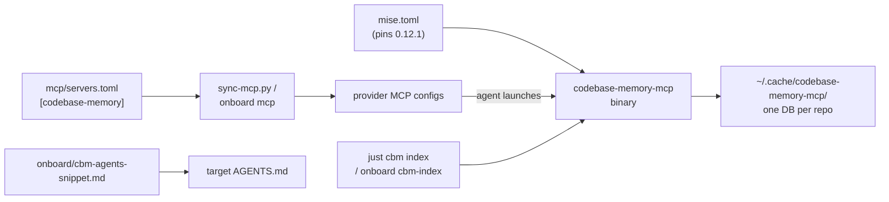

# Code graph (codebase-memory-mcp)

[codebase-memory-mcp](https://github.com/DeusData/codebase-memory-mcp) (CBM) indexes a repo
into a graph of functions, calls, routes, and packages. Agents query the graph over MCP
instead of grepping. This page covers how it is wired in here and what is still unverified.

## Goals and non-goals

- **Goal: one-step onboarding.** `just onboard all <repo> --apply` gives a repo the server, the pin, the index, and the agent note.
- **Goal: same model as everything else.** Registration goes through `mcp/servers.toml`, the pin through `mise.toml`, and every write is backed up.
- **Non-goal: CBM's own installer.** `codebase-memory-mcp install` is never run. See [conventions.md](./conventions.md#the-code-graphs-own-install-is-never-run).
- **Non-goal: proof of reachability.** The graph is static. It finds candidates; it does not prove code is used or unused.

## How the pieces fit

- **Server:** each agent starts `codebase-memory-mcp --ui=false` over stdio. The repo it serves is the agent's working directory.
- **Index:** built explicitly by `index_repository`. The server does not index on its own by default.
- **Cache:** one shared directory, one SQLite file per repo. The server and the `cbm/` recipes use the same one, so never set `CBM_CACHE_DIR`.
- **Agent note:** a marker-delimited block in `AGENTS.md`, sourced from one file so it exists once.

## What each piece does

| Piece | Where | Detail |
|---|---|---|
| Pin | `mise.toml` | `github:DeusData/codebase-memory-mcp` at `0.12.1`. It is not in the mise or aqua registries. Linux selects the static `-portable` asset, because the default Linux build needs glibc 2.38. |
| Server entry | `mcp/servers.toml` | `args = ["--ui=false"]` keeps CBM's loopback visualization server off. CBM persists that flag in its own config. |
| CLI recipes | `cbm/justfile` | See [recipes.md](./recipes.md#cbm--the-code-graph). |
| Onboarding | `scripts/onboard-repo.py` | `cbm-index` indexes a target. `agents-md` adds the note. `mise-tools` pins the binary. `mcp` registers the server. See [recipes.md](./recipes.md#onboard--onboarding-a-target-repo). |
| Agent note | `onboard/cbm-agents-snippet.md` | Tells agents to try `search_graph`, `trace_path`, `get_architecture`, and `detect_changes` first, and to fall back to grep for dynamic code. |

## What the graph is good and bad at

- **Good:** finding a symbol by name, listing callers and callees, mapping a diff to affected symbols, orienting in unfamiliar code.
- **Bad:** dynamic dispatch, dependency injection, reflection, and generated code. Unresolved calls get no edge.
- **Not proof:** "no callers" means "no static callers". Confirm before deleting anything.
- **Open upstream cases:** [#1114](https://github.com/DeusData/codebase-memory-mcp/issues/1114) (Go interface calls), [#2444](https://github.com/DeusData/codebase-memory-mcp/issues/2444) (Go Wire), [#1682](https://github.com/DeusData/codebase-memory-mcp/issues/1682) (TypeScript imports).

## What was verified

- **Install:** `mise install` fetched and ran `0.12.1` on macOS arm64 and the static
  portable binary on Linux x86-64 under Windows Subsystem for Linux (WSL).
- **Server:** with `--ui=false` it answered `initialize` and `tools/list` with 17 tools.
- **Rendering:** `just sync-mcp` wrote the entry for all four providers, and `just codex check` validated the Codex config.
- **Onboarding:** against a throwaway repo, dry-run, `--apply`, and a second `--apply` behaved as designed. The second run changed nothing.
- **Querying:** `just cbm search` found a known function in the indexed fixture.
- **Supply chain:** the installed Linux binary matched a SLSA provenance subject signed by
  the expected `_build.yml` workflow.
- **Infra coverage:** a sanitized `infra` clone produced 11,634 nodes and 22,838 edges
  across Terraform, Kubernetes, Ansible, Python, Bash, and YAML. Change impact mapped a
  temporary Python edit to three symbols.

## To confirm

Each item is unverified or only partly verified. Tick them off as you check.

### Install and supply chain

- [x] **Linux/WSL asset choice.** Mise selected the statically linked Linux x86-64
  portable binary under WSL. Linux arm64 remains unverified.
- [x] **Attestation check.** `gh attestation verify` matched the installed binary's SHA-256
  to SLSA provenance signed by
  `DeusData/codebase-memory-mcp/.github/workflows/_build.yml`.
- [x] **Pin freshness.** `0.12.1` was still the latest stable on 2026-11-13.

### Runtime behavior

- [x] **Loopback UI stays off.** `config list` showed `ui_enabled = false`, and no listener
  was present on `127.0.0.1:9749` during an initialized 12-second MCP session.
- [x] **Background daemon.** A one-shot CLI daemon exited after the client closed. No
  residual process remained after 15 seconds.
- [ ] **Auto re-index.** From source, an MCP session in an already-indexed repo watches and re-indexes in the background. Not observed. Confirm it behaves with a large repo and with a worktree.
- [x] **Codex handshake.** A cold MCP initialization took 4.93 seconds, within Codex's
  10-second default.

### Per-provider launch

- [ ] **Each agent finds the binary.** Codex listed the server as enabled and opencode
  connected. Claude found it but requires interactive project approval before connecting.
- [ ] **Antigravity.** Its MCP config format is already marked unverified in `scripts/sync-mcp.py`. The same caveat applies here.
- [ ] **Worktrees.** The session project is the agent's working directory. Confirm a claude-squad worktree maps to its own project, or find out how it maps to the main checkout's index.

### Data and security

- [x] **What gets stored.** CBM persists parsed graph data in SQLite. A root `.cbmignore`
  excluded `secrets.env`, SOPS files, key material, backups, and secret fixtures from the
  sanitized `infra` test.
- [x] **Index location.** The test index used 36 MiB under
  `~/.cache/codebase-memory-mcp`. Its directory and database were owner-only (`0700` and
  `0600`).
- [x] **Network use.** Indexing and queries run locally. After MCP initialization, CBM
  performs one best-effort GitHub release-metadata request. Upstream states that it sends
  no project data; see its
  [runtime network behavior](https://github.com/DeusData/codebase-memory-mcp/blob/v0.12.1/SECURITY.md#runtime-network-behavior).

### Coverage

- [x] **`infra` coverage.** The graph found Terraform resources, Kubernetes and Flux
  objects, Ansible tasks, Python call relationships, and shell entry points. Eight
  Jinja-heavy templates were unusable and 23 were partially parsed, so source inspection
  remains necessary for those files.
- [ ] **Reachability use.** The earlier reachability attempt did not work. Decide whether the graph is a hint source only, given the static limits above.
